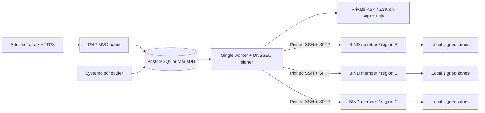

# ArzoieDNS

Self-hosted authoritative DNS administration: **PHP 8.5.12 or newer, a custom MVC framework, Bootstrap 5, BIND 9, DNSSEC, and SSH-managed member servers.** PostgreSQL and MariaDB are supported control-plane databases. Public DNS does not depend on PHP or the database.

Created by **Jaspreet Singh**. The rewritten application is licensed under [Apache License 2.0](LICENSE), with author attribution in [NOTICE](NOTICE). Distributed forks must retain applicable notices as required by the license. Third-party components retain their [separate licenses](THIRD_PARTY_NOTICES.md).

This repository replaces the former Python/SnitchDNS application. There is no automatic migration from its database. Historical versions in Git retain their original licenses; the new license applies to this rewritten application.

## Design



Record edits are drafts. Publishing creates an immutable revision with a new SOA serial. The worker validates and signs once, uploads the signed zone only to members missing that revision, validates it remotely, and reloads **only that zone**. New zones use `rndc addzone`; removals use `rndc delzone`. A member acknowledges only after a local authoritative SOA check. Failed/offline members remain pending. No global `rndc reload` occurs during normal deployment.

Members retain their zones and BIND's persistent dynamic-zone configuration across panel outages and restarts. DNSSEC signatures are valid for 30 days; a scheduled renewal creates a new revision with ten days remaining. An outage longer than signature validity will affect validating clients: monitor the signer and expiration reports.

## Implemented baseline

- Custom router, controllers, repositories, views, environment configuration, CSRF protection, secure sessions, Argon2id login, per-account lockout, and audit records.
- Dashboard, domain/record drafts, publish/delete actions, member onboarding/retry/drain/deboarding, deployment matrix, DNSSEC DS display, health reports, and job history.
- A/AAAA/CNAME/MX/TXT/NS/SRV/CAA/PTR validation; deterministic BIND zone rendering and CNAME/RRset checks.
- PostgreSQL/MariaDB schema; transactional revision publication and a retryable job queue.
- BIND smart signing, central ECDSA KSK/ZSK generation, signed artifact hashes and signature verification.
- Pinned SSH host keys, SFTP, encrypted short-lived bootstrap credentials, dedicated restricted sudo helper, OS preflight, and fresh-member provisioning.
- Local-zone rollback after failed load verification; durable deletion tombstones; periodic reconciliation and signing renewal.

## Platform policy

| Role | Platforms |
| --- | --- |
| Panel / worker | Enterprise Linux 10 or Debian 13+, with independently supplied PHP 8.5.12+ and BIND utilities |
| BIND members | Rocky Linux 10, AlmaLinux 10, Oracle Linux 10, RHEL 10; Debian 13+ |
| Database | PostgreSQL 16+ or MariaDB 10.11+ (InnoDB) |
| Unsupported | Ubuntu; EL 9 and older; Debian 12 and older; containers as production members |

Do not assume a distribution's default PHP packages meet the minimum. Installation intentionally does not silently add third-party repositories. RHEL package access requires valid subscriptions; Oracle/Rocky/Alma repositories must be configured by the operator. The platform matrix is a target policy, not a claim that live qualification has passed on every distribution.

## Start here

An [automated installer and certificate-management design](docs/installer-design.md) is specified for fixed HTTP/HTTPS ports **80/443**, an interactive database choice, long-term database maintenance, and later in-app TLS management. It is **planned, not implemented**; use the manual installation procedure below today.

**Contributors and AI agents:** start with [the contributor guide](CONTRIBUTING.md), [repository instructions](AGENTS.md), and [current handoff](HANDOFF.md). For coordinated simultaneous work, use [the parallel-work protocol](docs/ai/parallel-work.md) and [task board](docs/ai/tasks.md). Multiple coding agents do not change the single-worker production constraint.

1. Read [the architecture](docs/architecture.md), [security model](docs/security.md), and [installation guide](docs/installation.md).
2. Install PHP 8.5.12+ with PDO (`pdo_pgsql` or `pdo_mysql`), Sodium, mbstring, OpenSSL, and Argon2 support; Composer; and BIND signing utilities.
3. Run `composer install --no-dev --prefer-dist --classmap-authoritative`.
4. Copy `.env.example` to `.env`, configure the database and paths, and set `APP_KEY` using `php bin/arzoie key:generate`.
5. Run `php bin/arzoie migrate`, `php bin/arzoie user:create admin@example.com`, and `php bin/arzoie ssh:keygen` under the appropriate service accounts.
6. Configure HTTPS/PHP-FPM and the supplied worker and scheduler units. Point the web document root **only** at `public/`.
7. Onboard fresh members with console-verified fingerprints, add domains/records, publish, verify reports, and configure registrar delegation and DS records.

For local UI development only, set `APP_ENV=development`, configure a test database, and run `php -S 127.0.0.1:8080 -t public`. The built-in server is not a production deployment.

## Checks

```sh
composer validate --strict
php tests/lint.php
php tests/run.php
php tests/views.php
php tests/database.php            # isolated test database; see installation guide
bash tests/member-helper.sh      # mocked commands; never requires root
```

The standalone tests exercise input safety, zone rendering, selective sync decisions, platform policy, credential encryption, and remote-helper failure paths. Live BIND/DNSSEC, SSH, distro, firewall/MAC, database-engine and multi-region failure tests are mandatory before production. See [the delivery and acceptance plan](docs/roadmap.md) for outstanding work and the release gates. **This is an initial implementation, not a production-certified release.**

## Project structure

| Location | Responsibility |
| --- | --- |
| `public/` | Only web document root; HTTP entry point and local Bootstrap assets |
| `src/Core/` | Custom MVC/framework primitives, PDO, encryption, process execution and audit |
| `src/Controllers/` | Authentication, domains, member actions, overview and reporting HTTP adapters |
| `src/Models/` | Portable schema, transactional zone revisions and job persistence |
| `src/Dns/` | DNS rules, zone rendering, DNSSEC signing and selective sync decisions |
| `src/Infrastructure/` | Supported-OS policy and pinned SSH/SFTP transport |
| `src/Services/` | Provisioning, reconciliation, worker and maintenance orchestration |
| `views/` | Escaped PHP templates for the administration console |
| `resources/` | Member scripts, Nginx/FPM and systemd templates |
| `tests/` | Standalone, view, database and mocked member-helper checks |
| `bin/arzoie` | Administrative and worker CLI |
| `docs/` | Architecture, operations, security, plans, evidence and AI coordination |

See [the complete project map](docs/project-structure.md) for every maintained component, database entity, runtime path and request/deployment flow. Private configuration, dependencies and generated tools are intentionally excluded from source control.

## Working together

Give each contributor a bounded outcome and disjoint write paths. Keep schema, routes, shared protocol changes, dependencies and integration documentation under one coordinator. Use separate worktrees when the baseline is available in Git; in a shared checkout, preserve other contributors' edits and avoid branch switching or broad Git operations. See [the detailed protocol](docs/ai/parallel-work.md).

Use [HANDOFF.md](HANDOFF.md) to resume work, [the roadmap](docs/roadmap.md) for acceptance goals, and [validation](docs/validation.md) for executed evidence. These are distinct: implemented source is not proof that a live infrastructure scenario passed.

## Documentation

- [Documentation guide for humans and AI](docs/README.md)
- [Contributing and verification matrix](CONTRIBUTING.md)
- [Repository-wide instructions](AGENTS.md)
- [Current human/AI handoff](HANDOFF.md)
- [Complete project map](docs/project-structure.md)
- [AI task workflow](docs/ai/instructions.md)
- [Parallel ownership and integration](docs/ai/parallel-work.md)
- [Task board](docs/ai/tasks.md) and [handoff template](docs/ai/handoff-template.md)
- [Architecture and state machines](docs/architecture.md)
- [Installation and operation](docs/installation.md)
- [Automated installer and TLS design](docs/installer-design.md)
- [Security and trust boundaries](docs/security.md)
- [Delivery plan and acceptance tests](docs/roadmap.md)
- [Executed checks and validation limits](docs/validation.md)

Authoritative DNS answers are served by BIND. This application deliberately does not implement a DNS protocol server in PHP.
