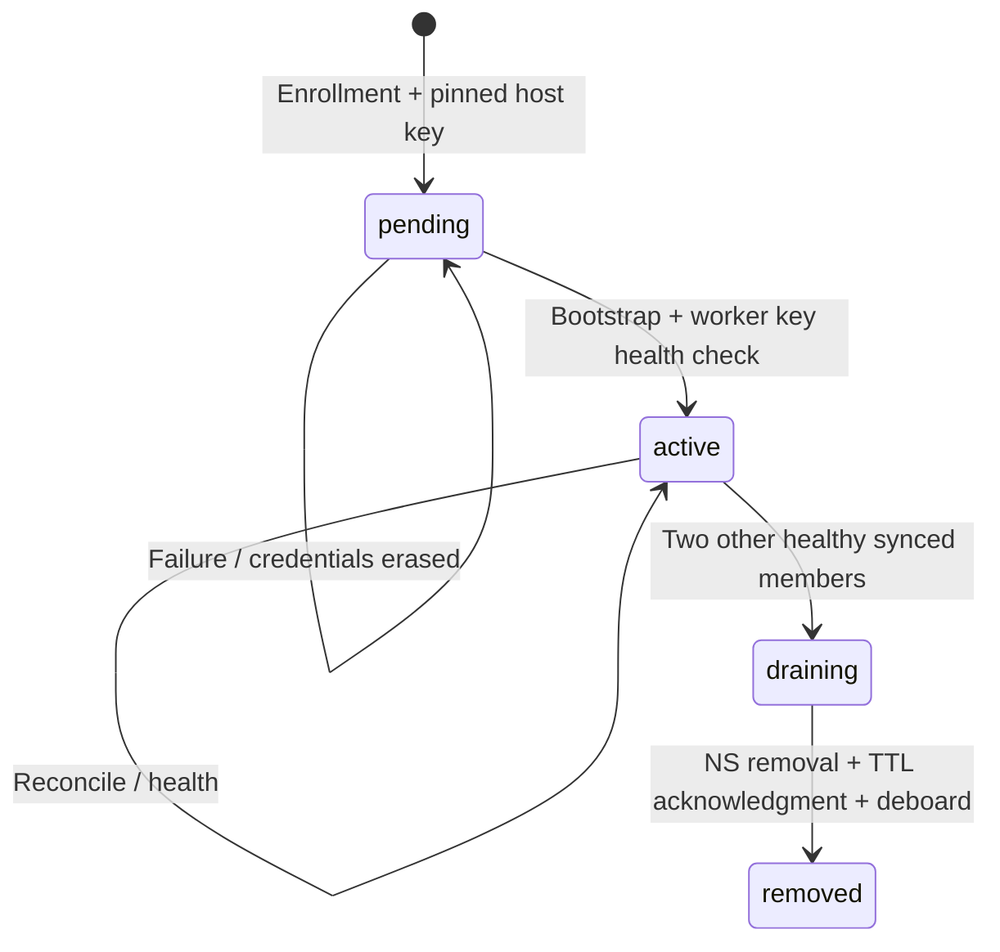

# Architecture

## Scope and boundaries

ArzoieDNS is a single-organization DNS control plane for multiple domains and multiple independently hosted authoritative nameservers. The UI uses Bootstrap assets served locally, without runtime CDN requests. Custom PHP MVC code owns routing, sessions, validation, SQL access and HTML views. phpseclib provides SSH cryptography and SFTP; BIND provides DNS protocol handling and DNSSEC primitives.

PHP 8.5.12 is the minimum and initial tested runtime; newer PHP releases must pass the same suite before qualification. PostgreSQL and MariaDB share a portable schema with explicit SQL, UTC timestamps and InnoDB transactions. SQLite is not a production backend. Exactly one worker holds a filesystem lock on the control host. A second control host must not start its own worker against the same database: distributed worker leadership is future work.

## Data model

| Entity | Purpose |
| --- | --- |
| users | Administrative identities, password hashes, login lockouts |
| zones | FQDN, SOA settings, monotonic serial, desired revision, deletion tombstone |
| records | Draft owner/type/TTL/value; one zone contains all of its names |
| zone_revisions | Immutable unsigned content and operation; signed file/hash/DS/expiry attached once |
| servers | Pinned host identity, connection, lifecycle, credential TTL, current health |
| deployments | Per-server/zone acknowledged revision, verification time and last error |
| jobs | Durable queue, attempts, eligibility time, processing state and diagnostic |
| audit_events | Actor, action, subject, details and UTC timestamp |

Initial schema installation is idempotent. It is not yet a versioned production migration system; future schema changes require numbered migrations and rollback plans before releases.

## Zone publication

1. Add/edit/remove draft records in a transaction with the zone row locked. Drafts are never directly exposed to BIND.
2. Publish locks the zone, increments its uint32 SOA serial, validates the complete draft, and stores a content snapshot. Desired revision and queue insertion commit together.
3. The worker reads the latest desired revision. Intermediate revisions not yet served can be coalesced: deploying obsolete content is unnecessary.
4. Sign once with a central KSK/ZSK set, verify using BIND tooling, and record the SHA256 digest. DNSSEC key material never leaves the signer.
5. Compare desired revision with each active member's applied revision. Equal means no upload, no reload.
6. SFTP to an unprivileged staging directory. The root-owned helper copies to a root-owned temporary file, validates the digest, zone and signatures, and atomically installs the file.
7. Existing zone: `rndc reload example.com`. New zone: `rndc addzone`. No service restart and no global reload.
8. Poll local BIND for an authoritative SOA with the expected serial. Return a structured receipt only on success. Update the deployment acknowledgment and audit event.
9. On failure, retain the previous acknowledgment, record the error, restore the last local file when possible, and retry with backoff. Success on one member never masks failure on another.

The database transaction does not span SSH. Delivery is at least once: a lost acknowledgment causes replay. Root-owned member receipts and authoritative checks make repeated operations safe. The helper rejects decreasing revision numbers. Repeated equal revisions revalidate/reload rather than assuming a receipt proves current service state.

Serials start at 1 and increment per publication, including signature renewal and deletion. Serial wrap is rejected pending an explicit RFC 1982 rollover procedure. Draft edits can be combined into one publish. Records cannot individually reload in BIND: a zone is the atomic reload/signing unit, so only affected zones are processed.

## Deletions

A zone removal creates a durable deletion revision. Every member, including ones that missed the original creation, must acknowledge that revision. The UI keeps the tombstone; no hard deletion or tombstone garbage collection is implemented. `rndc delzone` removes BIND's persistent zone registration. Last signed zone files remain on disk for recovery but are no longer served. Parent DS removal and registrar delegation changes are an operator responsibility.

## DNSSEC

Use BIND `dnssec-keygen` and `dnssec-signzone -S` with ECDSAP256SHA256 KSK and ZSK. This central pre-signing model gives all members identical DNSKEYs and signatures without distributing private keys. Public nodes serve pre-signed primary zones with updates, transfers, and NOTIFY disabled; SSH is the sole publication channel.

Signatures have a one-hour inception overlap and 30-day validity. The scheduler republishes the last published snapshot with a new SOA serial at ten days remaining; it never incorporates unpublished draft edits. A revision is signed once and reused on retries. An existing artifact whose digest changed or signatures expired is rejected. The database's expiry is a planned boundary; remote `dnssec-verify` is the cryptographic validation step.

Display generated SHA256 DS records for the registrar. **The current panel does not verify the parent DS or claim that a signed zone has a validated public chain of trust.** Automatic KSK/ZSK rollovers, parent DS observation, CDS/CDNSKEY automation and HSM integration are designed follow-on work. Until they are implemented, key replacement requires a documented manual overlap and registrar workflow; do not simply delete keys or toggle DNSSEC off.

## Member lifecycle

Onboarding uses one-time encrypted credentials with 15-minute expiry. Host keys are checked before credentials are submitted. Bootstrap reads `/etc/os-release` and accepts only explicit supported IDs/versions. It refuses an existing BIND installation on a first run. It installs distribution packages, creates the `arzoie-sync` account, enrolls the worker public key, installs the root-owned helper, configures authoritative-only BIND, local RNDC, MAC policy paths and additive firewall rules. Existing SSH login policy and operator access are preserved.

EL uses wheel membership; Debian uses sudo membership. A user-specific sudo policy removes general administrative privileges and grants only the helper. A bootstrap test refuses activation if `sudo true` still succeeds. Shell/SFTP access is unprivileged; the account cannot replace the helper, RNDC key or served zone files.

Deboarding is explicit and never a consequence of temporary health failure. Drain removes the server from future deployment selection while it keeps serving its last zones. Administrators publish NS changes on remaining members, update registrar delegation/glue, wait the relevant TTLs, then acknowledge removal. Deboard unregisters managed zones and revokes automation access; it retains BIND packages and signed files and does not change operator/root access.

## Job lifecycle and recovery

Jobs move queued → running → done, or return to queued with exponential delay. Five failed executions end in failed. The minute scheduler enqueues coalesced health/reconciliation work. An operator can retry failed jobs from CLI. Restarting the sole worker recovers its running jobs; operations must therefore tolerate replay. Bootstrap credentials are deliberately erased after any attempt, so a failed bootstrap requires fresh credentials rather than silently reusing a root password.

Reconciliation is incremental by revision, not by modification timestamps. Adding a new member backfills all desired zones and tombstones. A full periodic reconcile is cheap for equal revisions. Current health reports prove RNDC reachability, local BIND state, zone count and disk/load; they do not yet prove off-host UDP/TCP reachability, public delegation or content drift. Those are separate release gates.

## Failure behavior

| Failure | Behavior |
| --- | --- |
| Panel/database unavailable | Members keep serving local zones; no changes can publish |
| One member unreachable | Others update; that member remains pending |
| Upload interrupted | Served file unchanged; retry restages artifact |
| Invalid zone/signatures | Helper rejects before activation |
| BIND fails to load expected serial | Attempt local restoration; no acknowledgment |
| Worker dies after remote success | Replayed operation rechecks the authoritative SOA |
| Member restarts | BIND reloads its persisted addzone database and local files |
| Signer outage exceeds signature validity | DNSSEC validation fails; monitor and restore before expiry |
| Worker SSH key compromise | Managed zones on all enrolled members are at risk; revoke and replace promptly |

The first implementation deliberately favors understandable single-worker operation. Multi-controller leadership, multi-worker concurrency, a separate signing service and per-member SSH keys require additional protocols and are not implied by this design.
